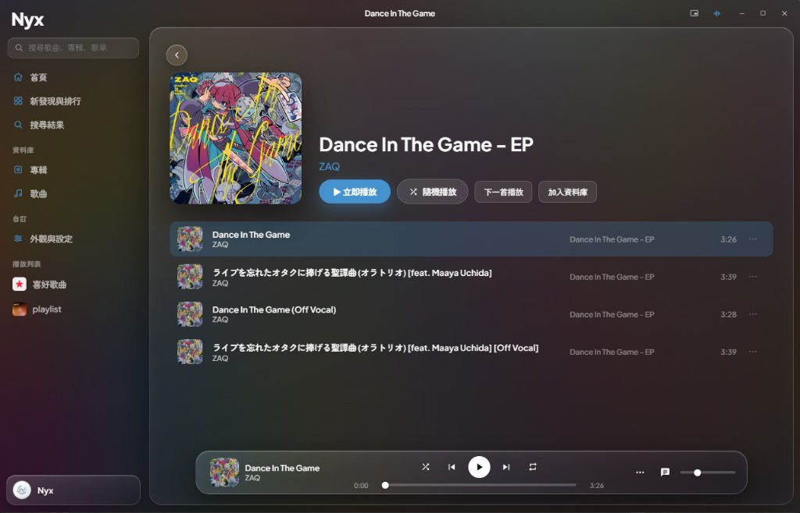
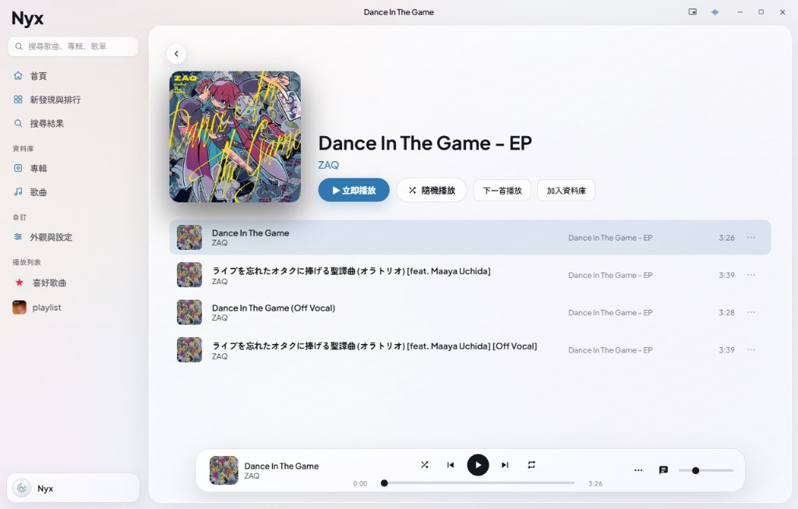
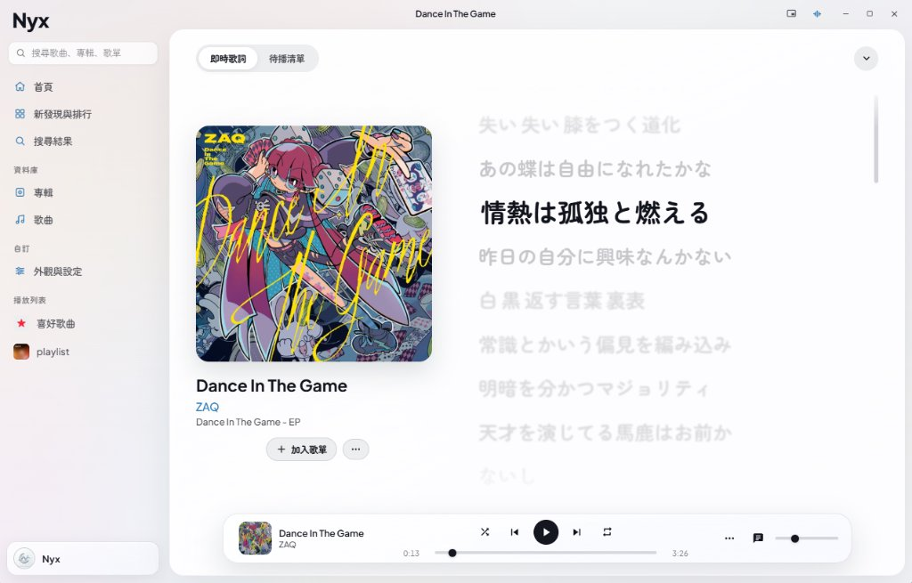

<div align="center">

# Nyx

Windows 平台上的 Apple Music 桌面客戶端，基於 Tauri v2 打造。

[](https://github.com/LonelyChord/Nyx/releases/latest)
[](https://github.com/LonelyChord/Nyx/releases/latest)
[](https://v2.tauri.app/)

[下載最新版本](https://github.com/LonelyChord/Nyx/releases/latest) · [回報問題](https://github.com/LonelyChord/Nyx/issues)

<br>



</div>

| 白色主題 | 即時歌詞 |
| :---: | :---: |
|  |  |

---

## 功能

- **外觀與主題**：深色／白色毛玻璃介面、動態專輯背景與自訂強調色
- **即時歌詞**：支援逐字同步歌詞、景深模糊與對齊切換
- **迷你置頂模式**：提供標準視窗與膠囊造型，支援透明與高斯模糊背景
- **字體與多語系**：支援繁中、簡中、英文、日文，可獨立設定中／英文字體
- **Discord Rich Presence**：同步顯示目前播放曲目、專輯封面與進度
- **無損切換與自動更新**：可一鍵切換至官方 Apple Music 播放無損，並支援軟體內自動檢查更新

## 安裝

1. 前往 [Releases](https://github.com/LonelyChord/Nyx/releases/latest) 下載最新的 `Nyx_x.x.x_x64-setup.exe` 安裝。
2. 後續更新可直接在「外觀與設定」中檢查並自動安裝。

## 開發與編譯

基於 Tauri v2，透過背景視窗介接 Apple Music Web `MusicKit`，並以 Windows Named Pipe 實作 Discord RPC。

```powershell
cargo build --release --manifest-path src-tauri/Cargo.toml
```

## 聲明

Nyx 為非官方的第三方開源專案，與 Apple Inc. 無任何關聯。所有串流內容皆透過 Apple Music 官方網頁版載入，使用前需登入個人有效訂閱帳號。

